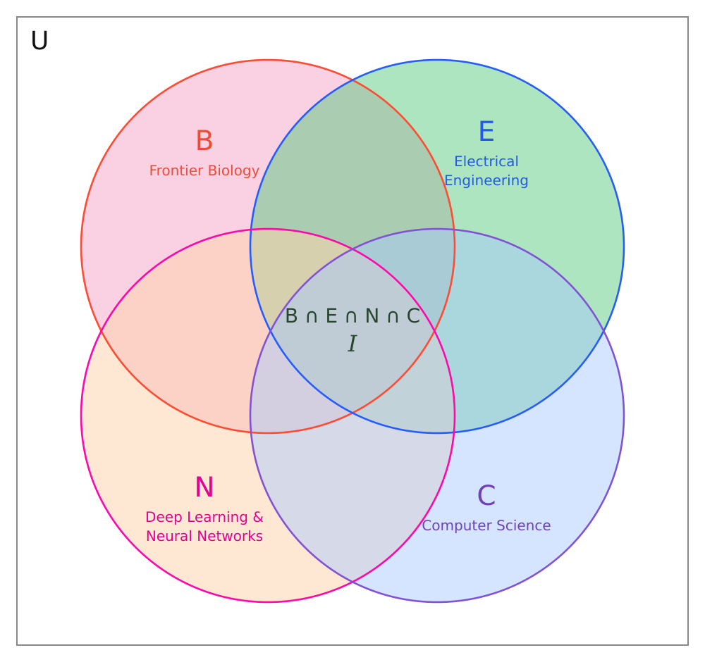

#### TL;DR
- Building LLMs and Neural Nets for Edge Devices
- Currently working on Diffusion Based Transformers
- In the meantime, designing PCBs
- Working on a custom 32bit MCU, and on a custom SOC board based on google CORAL Accelerator
- Love to experiment on my Spirogyra culture

